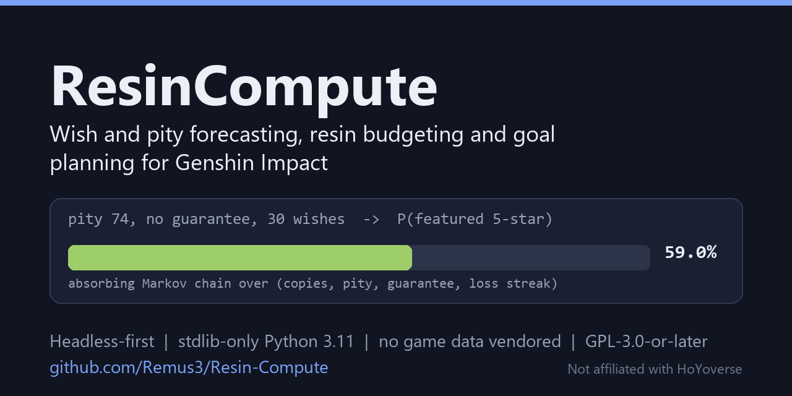

<p align="center">
  
</p>

# ResinCompute

**Gacha arithmetic for Genshin Impact - wish and pity forecasting, resin
budgeting and goal planning, off your own public Enka profile. Headless-first,
stdlib-only Python, no game data vendored.**

[](https://github.com/Remus3/Resin-Compute/actions/workflows/ci.yml)
[](https://github.com/Remus3/Resin-Compute/actions/workflows/docs-guards.yml)
[](https://www.python.org/downloads/)
[](requirements.txt)
[](LICENSE)

[What it is](#what-it-is) - [Status](#status) - [Quickstart](#quickstart) -
[Example](#example-output) - [How it works](#how-it-works) -
[How this repo is built](#how-this-repo-is-built) - [Docs](#documentation) -
[Licence](#licence)

**Not affiliated with, endorsed by, or connected to HoYoverse / miHoYo /
Cognosphere.** "Genshin Impact" and all associated names and material are their
property. This is an independent, non-commercial companion tool that vendors
none of their data.

## What it is

ResinCompute turns the parts of Genshin Impact that are arithmetic rather than
opinion into answers you can check. Its core is **PityEngine**
(`agents/pity_engine/`, HTTP `:8790`), a pure, deterministic gacha forecaster
with its own test suite. Roster data comes from a player's own public
Enka.Network showcase, through a client re-implemented from the published
protocol. It is a developer tool: no installer, no hosted page; everything runs
from a CLI or a background daemon, and the dashboard is optional.

Questions it is built to answer:

- I am 74 pulls in with no guarantee. What are my odds of landing the featured
  5-star inside my next 30 wishes? **Answered today.**
- I want two constellations and the signature weapon. How many wishes should I
  expect to spend, and how much does a guarantee change that? **Answered today.**
- I want this character at 90 with 9/9/9 talents. What does that cost in resin,
  and in what order? **Not yet** - `data/costs/` holds zero material rows, so
  the goal DAG and scheduler emit correct shapes with empty costs.

## Status

As of 2026-10-08. [`ROADMAP.md`](ROADMAP.md) is the live source; the full
table is in [`docs/OVERVIEW.md`](docs/OVERVIEW.md#status-in-full).

| | Area |
|---|---|
| **Shipped** | Wish forecaster (character, weapon, standard, Chronicled banners) - PityEngine HTTP service - headless lane with seven jobs, daemon and supervisor - Enka ingest - state persistence - goal DAG with cycle detection and critical path - row-scoped provenance schema - cross-repo responder - "by when" forecast over a caller-supplied banner schedule (POST /by-when; no calendar vendored) |
| **Partial** | Dashboard (six panels; a fresh clone renders 2 READY, 4 NOT_WIRED) - material costs (zero rows) - scheduler (day offsets, no calendar dates) - resin panel (hand-typed observation) - constellation talent mapping - artifact scoring (engine only, no table, no panel) - income velocity (default-off job over operator-typed observations) |
| **Planned** | banner calendar SOURCE (the "by when" route exists; nothing supplies the schedule yet) - team solver |

## Quickstart

Python 3.11 or newer. The runtime is stdlib only; only the dev toolchain needs
installing. Commands are PowerShell (the project is developed on Windows); a
POSIX equivalent of the forecast call is in
[`docs/OPERATIONS.md`](docs/OPERATIONS.md#the-engine-the-lane-the-supervisor-and-the-dashboard).

```powershell
git clone https://github.com/Remus3/Resin-Compute.git
cd Resin-Compute
python scripts/install_hooks.py          # FIRST: a fresh clone runs no hooks
python -m pip install --require-hashes -r requirements.txt
python -m pip install --require-hashes -r requirements-dev.txt

python -m pytest tests                   # application suite
python -m pytest agents/pity_engine      # engine suite - run the two separately
```

Start the engine, then ask it the first question above from a second console:

```powershell
python -m agents.pity_engine --port 8790

$body = @{ banner = 'character_event'; pity_5star = 74; has_guarantee = $false
           consecutive_5050_losses = 0; target_count = 1; pull_budget = 30 } |
        ConvertTo-Json
Invoke-RestMethod -Method Post -Uri http://127.0.0.1:8790/forecast `
  -ContentType 'application/json' -Body $body
```

The engine (8790) and the dashboard (8791, `python -m surface`) bind to
`127.0.0.1` and **do not authenticate** - do not expose them to a network you do
not control. Any path works for the checkout, spaces included. Bootstrap, the
headless lane, the supervisor and everything else: [`docs/OPERATIONS.md`](docs/OPERATIONS.md).

## Example output

The response to that request, reproduced from the engine on 2026-10-03:

```json
{
  "status": "ok",
  "engine_version": "0.1.0",
  "probability": 0.5904331542650183,
  "pull_budget": 30,
  "target_count": 1,
  "banner": "character_event",
  "distribution": [
    0.40956684573498164,
    0.5904331542650183
  ],
  "expected_pulls": 33.82161353538069
}
```

A 59.0% chance of at least one copy inside 30 pulls, 41.0% of none, and about 34
pulls expected to the first copy from this state. `distribution[k]` is the
probability of exactly `k` copies.

## How it works

- **Forecaster.** An absorbing Markov chain over
  `(copies, pity, guarantee, loss_streak)`, never a binomial on 1.600% (that is
  a long-run average, not a per-wish probability). Three easy-to-get-wrong
  constants are regression-tested: the 55.000% consolidated 50/50 since version
  5.0, the weapon soft-pity ramp saturating at pull 77, and the pull budget a
  probability needs. Detail:
  [`docs/OVERVIEW.md`](docs/OVERVIEW.md#what-the-forecaster-models).
- **Ingest.** `ingest/enka_client.py` sends a required custom User-Agent,
  honours `ttl` on every response and refuses UID enumeration.
- **Headless lane.** `headless/runner.py` runs seven registered jobs
  (`sync_profile`, `reconcile_state`, `reconcile_ledger`, `persist_state`,
  `recompute_plan`, `forecast_pity`, `emit_health`) once, as a daemon, or under
  `ops/supervisor.py`, which restarts it and writes a health file.
  `reconcile_ledger` folds a hand-typed data/income_observations.json into the
  ledger and is a SKIP until that file exists. Each live pass holds a slot from
  a vendored machine-wide concurrency governor (`ops/loop/`), so parallel
  background lanes on one machine queue rather than collide.
- **Planning.** `engines/` holds the goal DAG, a resin-, rotation- and weekly
  lockout-aware scheduler and a recommendation solver - mechanism only, waiting
  on first-hand cost rows.
- **Surfaces.** A local dashboard (`surface/`) whose panels declare READY,
  PARTIAL or NOT_WIRED instead of showing placeholder numbers, and an optional
  Electron tray companion (`shell/`, ADR-005).
- **Data.** None vendored. `data/fixtures/` is hand-authored; every future row
  in `data/` must carry a provenance receipt (`docs/PROVENANCE_SCHEMA.md`).
  Posture and refused sources: [`docs/LICENSE_NOTES.md`](docs/LICENSE_NOTES.md).

### Things that act outside the checkout

None of these run unless you invoke them, and none is needed by the Quickstart.
Removal commands are in
[`docs/OPERATIONS.md`](docs/OPERATIONS.md#the-windows-scheduled-tasks-and-how-to-remove-them).

- `ops/install_scheduled_task.ps1` registers a **hidden** logon task at the
  highest available privilege with no time limit; it outlives the clone.
- `ops/install_responder_task.ps1` registers a **hidden** five-minute responder
  task for an agreed window; its definition also outlives the clone.
- `tools/screen_capture.py` (with `tools/first_run_capture.py` and
  `tools/capture_supervisor.py`) writes **full-screen** screenshots to disk.
- `tools/wish_authkey.py` handles a short-lived Wish History credential; see
  [`SECURITY.md`](SECURITY.md).

## How this repo is built

One person (the operator) builds this repository with AI coding agents, using
Claude Code. The operator sets the direction and owns every commit; the agents
write most of the code, tests and documents. The process is written down in
the repository and enforced by tests, hooks and CI, so it can be read rather
than taken on trust:

- **`CLAUDE.md`** is the instruction file every agent session reads first: the
  project's hard rules, test commands and domain constants. Its top block is a
  shared rule set copied unedited into each of the operator's repositories;
  the rest is specific to this one. `docs/claude-md-history.md` keeps the
  reasoning behind each rule.
- **`.claude/`** holds the agent roster (`.claude/agents/`), the session
  commands (`.claude/commands/`), the hook settings and
  `.claude/session-default.md`. Work is split into slices that touch disjoint
  files, built in parallel by separate agents, then checked by a different
  agent whose job is to refute the result - the agent that produced a change
  never grades it
  ([`docs/adr/ADR-007-orchestration-doctrine.md`](docs/adr/ADR-007-orchestration-doctrine.md)).
- **`.githooks/`** is the authoritative gate, inert until
  `python scripts/install_hooks.py` points git at it: ASCII and glyph checks
  and commit-message shape at commit time, then lint and a fast (`not slow`)
  test selection, narrowed to what the push changed, before a push. CI on
  Python 3.11 runs the engine suite in full and the application suite scoped
  to the change, and a daily scheduled run covers every module
  ([`CONTRIBUTING.md`](CONTRIBUTING.md)).
- **`ops/`** holds the supervisor and the Windows scheduled-task definitions,
  plus two vendored directories pinned by digest: `ops/fleet_kit/` (the shared
  tooling for agent runs - spawn, locks, checklists) and `ops/loop/` (a
  machine-wide concurrency governor). Agent runs that happen without anyone
  watching go through that kit and are logged
  ([`docs/OPERATIONS.md`](docs/OPERATIONS.md#the-engine-the-lane-the-supervisor-and-the-dashboard)).
- **`RSC-NEXT-SESSION.txt`** is the hand-off: the one file that carries open
  work from one session to the next. Closed work is recorded in
  [`docs/LEDGER.md`](docs/LEDGER.md) and open work in [`ROADMAP.md`](ROADMAP.md).
- **Cross-repository notes** between the operator's repositories are
  SHA-256 checked and answered by a scheduled responder -
  [`docs/CHANNEL.md`](docs/CHANNEL.md).

The licence is the GNU General Public License, version 3 or (at your option)
any later version (GPL-3.0-or-later): free software, with source available to
anyone who receives a copy. Three vendored parts keep their own Apache-2.0
grant: `ops/fleet_kit/`, `ops/loop/slots.py` with `ops/loop/winmutex.py`, and
`docs/CHANNEL.md`. See [Licence](#licence) below.

## Documentation

| Read | For |
|---|---|
| [`docs/OVERVIEW.md`](docs/OVERVIEW.md) | Full status, direction, the forecaster's model, data posture, why Python |
| [`docs/OPERATIONS.md`](docs/OPERATIONS.md) | Running everything, scheduled tasks and removal, ports, conventions |
| [`docs/SPEC_SCAFFOLD.md`](docs/SPEC_SCAFFOLD.md) | The build contract and the verified gacha constants |
| [`docs/adr/README.md`](docs/adr/README.md) | Architectural decisions, indexed |
| [`ROADMAP.md`](ROADMAP.md) / [`docs/LEDGER.md`](docs/LEDGER.md) | Open work / closed work, newest first |
| [`docs/LICENSE_NOTES.md`](docs/LICENSE_NOTES.md) | What may and may not be consumed |
| [`CONTRIBUTING.md`](CONTRIBUTING.md) - [`SECURITY.md`](SECURITY.md) - [`CODE_OF_CONDUCT.md`](CODE_OF_CONDUCT.md) | Gates and the no-vendoring rule - private vulnerability reports - Contributor Covenant 2.1 |

## Repository tree

Top-level folders and the four entry points. The per-file tree is in
[`docs/OVERVIEW.md`](docs/OVERVIEW.md#repository-tree). Both are guarded by
`tests/test_readme_tree.py`: every path named must exist and be stored by git.

```
<checkout>/
  .claude/                 agent roster and session commands
  .githooks/               the authoritative gate, inert until installed
  .github/                 CI workflows
  agents/
    pity_engine/
      __main__.py          ENTRY: PityEngine HTTP service on 8790
  core/                    the shared contract and the primitives
  data/                    hand-authored fixtures, empty cost tables
  docs/                    overview, operations, ADRs, ledger
  engines/                 goal DAG, scheduler, recommendation solver
  headless/
    runner.py              ENTRY: the headless lane, once or as a daemon
  ingest/                  Enka client and mapper
  ops/
    supervisor.py          ENTRY: lane watchdog, writes the health file
  scripts/                 install_hooks.py first, then the data bootstrap
  shell/                   Electron tray companion
  surface/
    __main__.py            ENTRY: the dashboard on 8791
  tests/                   the application suite
  tools/                   gates, capture lane, Wish History tool
```

`ops/loop/` is digest-pinned against copies in other repositories; why a single
count over that directory is the wrong summary is in
[`docs/OPERATIONS.md`](docs/OPERATIONS.md#on-opsloop-and-its-two-carrier-populations).

## Licence

**GPL-3.0-or-later.** See `LICENSE` for the full text and `NOTICE` for the
copyright line; ADR-006 records why. You may use, study, modify and redistribute
this, including commercially, but any derivative you distribute must carry the
same licence and its source must be available.

Some vendored files carry their own grant, all Apache-2.0:

- `ops/fleet_kit/` is the operator's FLEET-KIT, with its own `LICENSE` and
  `NOTICE` retained unedited beside it.
- `ops/loop/slots.py` and `ops/loop/winmutex.py`, the concurrency governor,
  are byte-identical copies from another of the operator's repositories.
- `docs/CHANNEL.md` is likewise a byte-identical copy.

Their provenance is recorded in `docs/LICENSE_NOTES.md`. Apache-2.0 code may be
combined into a GPL-3.0-or-later work, so the combined work still ships under
`LICENSE`.

That licence covers this project's own code only. It grants nothing over
Genshin Impact's data, names, statistics or assets, which belong to HoYoverse;
what this project may consume is a separate question, answered in
`docs/LICENSE_NOTES.md`.
